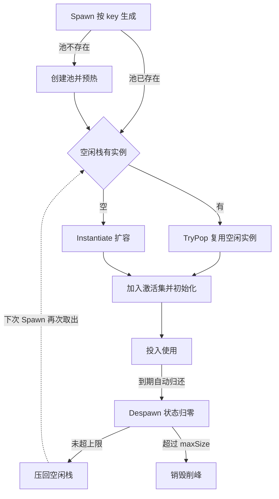

在游戏开发中，场景里总存在大量需要频繁生成与销毁的物体——投掷物、特效、掉落物。如果每次都走 `Instantiate` / `Destroy`，不仅产生可观的内存分配，还会触发 GC spike，在帧率敏感的场景里表现为肉眼可见的卡顿。

对象池（Object Pool）是解决这类问题的经典方案：**预先创建、用后归还、循环利用**。这篇文章介绍一套轻量级 Unity 对象池实现——核心只有三个文件、约百行代码，职责清晰，可以直接拷进项目使用。

:::tip
对象池的核心收益不是"少 new 几个对象"，而是把内存分配从运行时尖峰转移到加载期的一次性预热（prewarm），换取帧率的平稳。
:::

---

## 1. 整体结构

整套池系统由三个角色组成：

| 文件 | 职责 |
| :--- | :--- |
| `PoolManager.cs` | 全局单例管理器，维护 `key → ObjectPool` 的字典，对外提供统一的 `Spawn` / `Despawn` 入口；`PoolableBehaviour` 基类也定义在这里 |
| `ObjectPool.cs` | 单个池体，负责某一种预制体的预热、取出、归还与容量控制 |
| `PooledCast.cs` | 池化物体示例——一个投掷物，演示如何继承 `PoolableBehaviour` 实现业务初始化与状态重置 |

一次完整的"生成 → 使用 → 归还"循环：



---

## 2. 基类约定与全局管理器

所有可被池化的物体都继承 `PoolableBehaviour` 基类。它约定了两个由子类实现的行为——生成时的初始化与回收时的清理；而绑定关系（`Bind` / `Owner`）这层样板由基类统一实现，子类一行都不用写。

`PoolManager` 是一个挂在场景里的 `MonoBehaviour` 单例，通过 `DontDestroyOnLoad` 跨场景存活：

```csharp title="PoolManager.cs"
public abstract class PoolableBehaviour : MonoBehaviour
{
    public ObjectPool Owner { get; private set; }

    public void Bind(ObjectPool op) => Owner = op;

    public abstract void Spawn();    // 每次复用时的业务初始化
    public abstract void Despawn();  // 归还时的状态归零
}

public class PoolManager : MonoBehaviour
{
    public static PoolManager Instance { get; private set; }
    private readonly Dictionary<string, ObjectPool> _pools = new Dictionary<string, ObjectPool>();

    private void Awake()
    {
        if (Instance != null && Instance != this)
        {
            Destroy(gameObject);
            return;
        }
        Instance = this;
        DontDestroyOnLoad(gameObject);
    }

    public GameObject Spawn(string key, Transform parent, GameObject prefab = null)
    {
        if (!_pools.ContainsKey(key))
        {
            _pools.Add(key, new ObjectPool(key, parent, prefab, 6));
        }
        return _pools[key].Spawn();
    }

    public void Despawn(PoolableBehaviour item)
    {
        item.Owner?.Despawn(item);
    }
}
```

这里有三个设计点值得说明：

- **基类而非接口**：池化对象约定俗成都是 `MonoBehaviour`，用抽象基类替代接口后，`gameObject` / `transform` 天然在手，池内不再需要 `GetComponent` 或包装类型来"翻译"两种视角；代价是占掉 C# 唯一的基类位；
- **懒加载建池**：第一次用某个 `key` 调用 `Spawn` 时才创建对应的池，避免为永远用不到的预制体浪费内存；
- **归还无需指定池**：`Despawn` 只传物体本身，通过基类上的 `Owner` 反向找到它所属的池——调用方完全不用关心池的存在；`?.` 兜底未绑定的情况，不抛空引用。

---

## 3. 池体：双集合 O(1) 存取

`ObjectPool` 是普通 C# 类（不继承 `MonoBehaviour`），内部用**两个集合**分管两种状态的实例：`Stack` 存空闲实例，`HashSet` 存激活实例：

```csharp title="ObjectPool.cs"
public class ObjectPool
{
    private readonly Stack<PoolableBehaviour> _idle = new Stack<PoolableBehaviour>();
    private readonly HashSet<PoolableBehaviour> _active = new HashSet<PoolableBehaviour>();
    private readonly string key;
    private readonly int maxSize;
    private readonly Transform root;
    private readonly GameObject _object;

    public ObjectPool(string key, Transform parent, GameObject pb = null, int prewarm = 10, int maxSize = 20)
    {
        this.maxSize = maxSize;
        this.key = key;
        this.root = parent;
        _object = pb ? pb : Object.Instantiate(Resources.Load<GameObject>("PoolPrefabs/" + key), root);
        for (int i = 0; i < prewarm; i++)
        {
            var item = CreateInstance();
            item.gameObject.SetActive(false);
            _idle.Push(item);
        }
    }

    // 唯一的实例化入口，也是唯一的 GetComponent 调用点——每个物理实例一生一次
    private PoolableBehaviour CreateInstance()
    {
        var go = Object.Instantiate(_object, root);
        var item = go.GetComponent<PoolableBehaviour>();
        if (item == null)
            throw new System.Exception($"[ObjectPool] 预制体 {key} 缺少 PoolableBehaviour 派生组件");
        item.Bind(this);
        return item;
    }

    public GameObject Spawn()
    {
        if (!_idle.TryPop(out var item))
        {
            item = CreateInstance();   // 栈空自动扩容
        }
        _active.Add(item);
        item.gameObject.SetActive(true);
        item.Spawn();
        return item.gameObject;
    }

    public void Despawn(PoolableBehaviour item)
    {
        item.Despawn();
        _active.Remove(item);
        if (_idle.Count > maxSize)
        {
            Object.Destroy(item.gameObject);
        }
        else
        {
            item.gameObject.SetActive(false);
            _idle.Push(item);
        }
    }
}
```

池体的三段生命周期逻辑：

1. **预热（prewarm）**：构造时按 `prewarm` 数量提前实例化，全部置为未激活后压入空闲栈。如果调用方没传预制体，就按 `key` 去 `Resources/PoolPrefabs/` 下加载；
2. **取出（Spawn）**：直接从空闲栈 `TryPop`，O(1) 拿到可复用实例并登记进激活集；栈空了就现场 `Instantiate` 扩容——**池不会因为预热数量耗尽而拒绝服务**；
3. **归还（Despawn）**：先调用物体自身的 `Despawn()` 清理状态，再把它从激活集移除；空闲数超上限就销毁削峰，否则停用后压回空闲栈。

两个细节值得注意：

- **`GetComponent` 一生一次**：组件引用在 `CreateInstance` 里拿到后就一直留在集合里流通，热路径上不再有任何 `GetComponent`；预制体没挂派生组件时当场抛出带 `key` 的异常，而不是让空引用在别处炸开；
- **为什么要用两个集合而不是一个**：如果只用一个集合存所有实例，取出时就得线性扫描找未激活对象，复杂度是 O(n)。拆成"空闲栈 + 激活集"后，取出是 `TryPop`、归还是 `Remove` + `Push`，全部 O(1)；激活集还顺带支撑了"强制全池回收"这类扩展的可能性。

:::warning
归还时先调 `Despawn()` 再做 `SetActive(false)` 的顺序很重要：物体需要在仍然激活的状态下完成自身状态清理（比如停止协程），否则 `StopAllCoroutines` 之类的调用可能因物体已停用而行为异常。
:::

---

## 4. 池化物体示例：PooledCast

`PooledCast` 是一个投掷物，演示池化物体的标准实现模板——**`Spawn` 里做业务初始化，`Despawn` 里做状态归零**：

```csharp title="PooledCast.cs"
public class PooledCast : PoolableBehaviour
{
    private Rigidbody rb;
    private Transform t;

    private void Awake()
    {
        rb = GetComponent<Rigidbody>();
        t = GetComponentInParent<Transform>();
    }

    public override void Spawn()
    {
        // 业务初始化：施加带随机扰动的初速度与随机扭矩（与池无关，此处从略）
        StartCoroutine(AutoReturn());
    }

    private IEnumerator AutoReturn()
    {
        yield return new WaitForSeconds(1f);
        PoolManager.Instance.Despawn(this);   // 直接传自己
    }

    public override void Despawn()
    {
        StopAllCoroutines();
        rb.linearVelocity = Vector3.zero;
        rb.angularVelocity = Vector3.zero;
        transform.localPosition = Vector3.zero;
        transform.localRotation = Quaternion.identity;
    }
}
```

对池化物体来说，`Spawn` / `Despawn` 本质上承担了"构造与析构"的职责：

- **`Spawn()`** 里做每次复用都要重来的业务初始化，并启动自动归还逻辑（这里用协程演示 1 秒后归还，实际项目也可以由碰撞、计时器等触发）；
- **`Despawn()`** 里做状态归零：停掉所有协程（防止上次残留的自动归还协程在新一轮生命周期里误触发）、清空刚体速度与角速度、复位局部坐标与旋转。

由于基类已经处理掉了绑定关系，新增一个池化类型只需要写这两个方法——没有接口样板，没有 `owner` / `Bind` / `GetPool` 三件套。

:::tip
产生脏数据,如果销毁或生成时不进行数据的清空和初始化,下次生成对象时会带着上一次的状态。
:::

---

## 5. 使用方式

调用方只需要面对 `PoolManager` 一个入口：

```csharp title="调用示例"
// 生成：指定 key 与父节点（首次调用会自动建池并预热 6 个实例）
GameObject cast = PoolManager.Instance.Spawn("Cast", throwPoint);

// 归还通常由对象自己发起（如上面协程里的 Despawn(this)）；
// 外部只持有 GameObject 时，取一次组件再归还即可
PoolManager.Instance.Despawn(cast.GetComponent<PoolableBehaviour>());
```

`key` 同时承担两个职责：池的字典索引，以及（在没传预制体时）`Resources/PoolPrefabs/<key>` 的加载路径。

---

整套实现没有反射、没有泛型约束，也不依赖任何第三方库，三个文件即可落地。如果项目规模增长，可以在这个骨架上按需扩展——比如建池时透传自定义 `prewarm` / `maxSize`、按场景清空池、或给 `PoolableBehaviour` 增加 `OnSpawned` / `OnDespawned` 虚方法钩子。而当调用方需要频繁操作具体组件类型时（`Spawn` 后直接往子类塞参数），再考虑引入泛型池也不迟。
